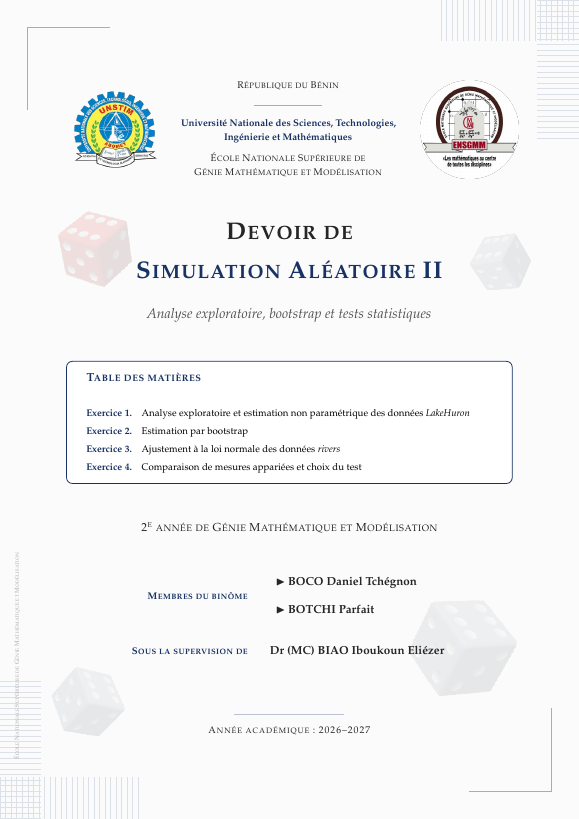
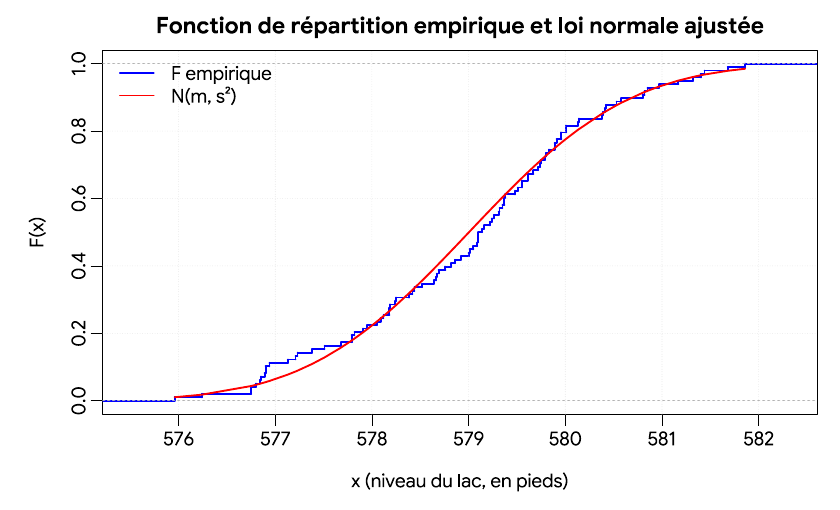
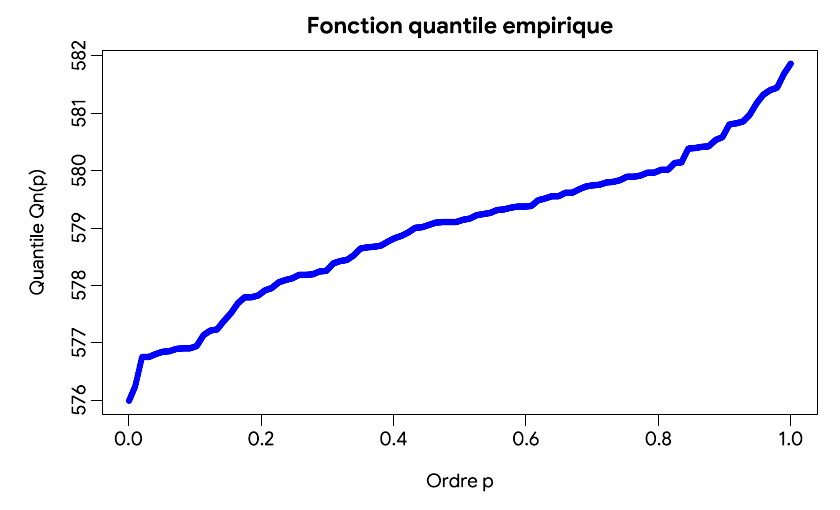
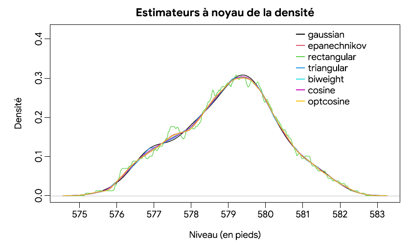
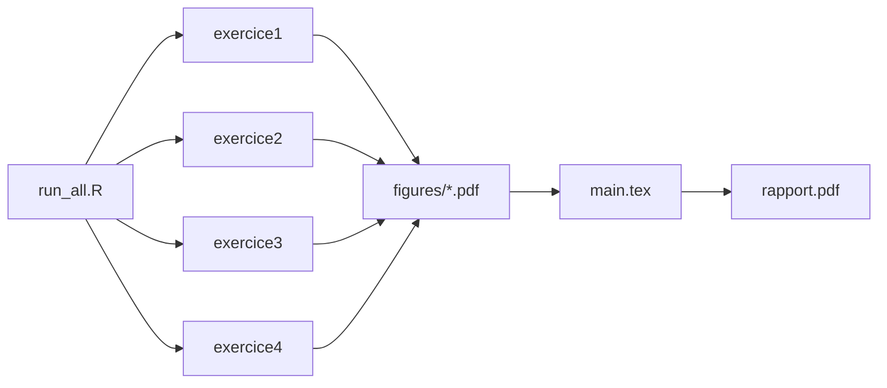

# Simulation Aléatoire II — Devoir


Devoir de **Simulation Aléatoire II** (2<sup>e</sup> année de Génie Mathématique et Modélisation,
ENSGMM / UNSTIM, année académique 2026–2027).

**Binôme :** BOCO Daniel Tchégnon · BOTCHI Parfait
**Encadrant :** Dr (MC) BIAO Iboukoun Eliézer

[](docs/Devoir_Simulation_Aleatoire_II.pdf)

**[📄 Lire le rapport (PDF)](docs/Devoir_Simulation_Aleatoire_II.pdf)**

## Résultats clés

• **Exercice 1** : le modèle normal est une approximation raisonnable pour `LakeHuron`.
• **Exercice 2** : IC bootstrap à 95 % de la médiane : [61 ; 83] (stable dès B = 5 000).
• **Exercice 3** : Shapiro–Wilk et Kolmogorov–Smirnov rejettent la normalité de `rivers`.
• **Exercice 4** : les trois tests (t apparié, signe, Wilcoxon) concluent à une hausse des bactéries en 24 h.

## Aperçu des figures

| Fonction de répartition | QQ-plot | Estimateurs à noyau |
|:--:|:--:|:--:|
|  |  |  |

## Flux de travail



## Contenu

| Exercice | Thème | Données | Script |
|---|---|---|---|
| 1 | Analyse exploratoire et estimation non paramétrique | `LakeHuron` | [`R/exercice1_lakehuron.R`](R/exercice1_lakehuron.R) |
| 2 | Estimation par bootstrap | 24 maxima annuels de précipitations | [`R/exercice2_bootstrap.R`](R/exercice2_bootstrap.R) |
| 3 | Ajustement à la loi normale (Shapiro–Wilk, Kolmogorov–Smirnov) | `rivers` | [`R/exercice3_rivers.R`](R/exercice3_rivers.R) |
| 4 | Mesures appariées (test $t$, signe, Wilcoxon) | bactéries dans le lait (8 vaches) | [`R/exercice4_apparies.R`](R/exercice4_apparies.R) |

## Structure

```
.
├── R/
│   ├── style_graphique.R    police et mise en page communes des figures
│   ├── exercice1_lakehuron.R
│   ├── exercice2_bootstrap.R
│   ├── exercice3_rivers.R
│   └── exercice4_apparies.R
├── figures/                 figures générées par les scripts, logos et images du rapport
├── docs/                    rapport compilé (PDF)
├── main.tex                 rapport LaTeX
├── run_all.R                exécute les quatre exercices
├── Simulation-Aleatoire-2.Rproj   projet RStudio
└── README.md
```

## Reproduire les résultats

Prérequis : R (≥ 4.0) et les paquets `boot` et `showtext`.
Les jeux de données `LakeHuron` et `rivers` sont fournis par R.

Avec RStudio, ouvrir `Simulation-Aleatoire-2.Rproj` : le répertoire de travail est alors la racine du dépôt.
Sinon, se placer à la **racine** du dépôt avant de lancer les scripts :

```bash
Rscript run_all.R                       # tout
Rscript R/exercice2_bootstrap.R         # un seul exercice
```

Les scripts affichent les résultats dans la console et écrivent les figures `fig_*.pdf`
dans `figures/`. L'exercice 2 fixe la graine (`set.seed(123)`), donc ses valeurs sont reproductibles.

### Police des figures

Les figures utilisent la police Google Sans. Le chemin du dossier de la police se règle
au début de [`R/style_graphique.R`](R/style_graphique.R). Si les fichiers `.ttf` sont
introuvables, la police par défaut de R est utilisée.

## Compiler le rapport

```bash
pdflatex main.tex
pdflatex main.tex
```

Le deuxième passage résout les références. Le rapport utilise les figures `fig_*.pdf` ainsi que
`logo_unstim.png`, `logo_ensgmm.png`, `de_unique.png` et `de_unique_2.png`, qui doivent se trouver
dans `figures/`. Une distribution TeX Live ou MiKTeX complète suffit.

L'en-tête et le pied de page sont repris de la classe
[`upbcours`](https://github.com/Parfait0123/upbcours).
